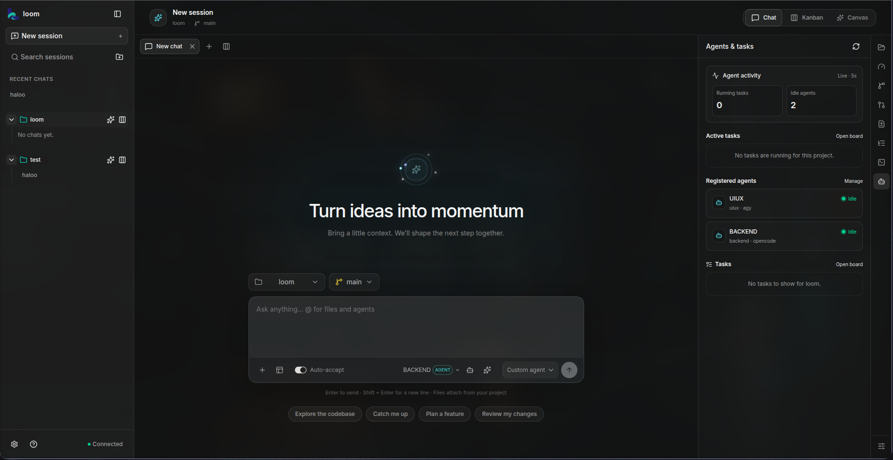

<div align="center">

# Loom

**A clear desk for parallel coding agents.**

Plan the work, let agents build side by side in isolated Git worktrees, and approve every line before it touches your branch.
Your repositories, sessions and state stay on your machine.


[Install](#install) · [First run](#your-first-run) · [Features](#what-you-can-do) · [Development](#development) · [Architecture](#architecture)

</div>

---



Loom is a local-first workspace for agentic development. Instead of one terminal, one agent and a lot of window switching, you describe the goal, review the plan, and let several agents work in parallel — each in its own worktree and branch — while you keep the review and merge decisions.

## What you can do

### Plan before any agent starts

Turn a goal into a task plan with explicit dependencies, acceptance criteria and validation commands. Edit the breakdown, approve the commands, then choose what happens next: review first, create tasks, or create and start.

### Give every task its own workspace

Each task runs in a real Git worktree on its own branch under `~/.loom/worktrees`. Concurrent agents cannot step on your main checkout, and you can open any retained worktree with your editor and normal Git commands.

### Let independent work actually run in parallel

The scheduler dispatches ready tasks within bounded concurrency (defaults: 3 agents overall, 3 per project, 2 per provider). Dependent tasks wait and receive the contract from the work they build on. Follow progress on the Kanban board through `queued → ready → preparing → running → completed`, plus `blocked`, `ready_to_merge`, `merge_conflict`, `failed` and `cancelled`.

### Review, then merge — never automatically

Loom brings task branches together in a separate integration workspace, runs your checks, and presents a combined diff. Approval is bound to the exact commit you reviewed; if the result changes, you review the new head again. Conflicts go to a resolver, checks re-run, and the merge still needs you.

### Chat with the runtime you want

OpenCode is the primary runtime for chat and task execution. Loom also connects supported local CLIs — Claude Code, Codex CLI and Antigravity CLI — for chat. Pick a provider, model, custom agent and thinking mode per message, and switch mid-conversation.

### Keep the whole process in one view

Multiple chat tabs and a split view for separate workstreams, plus a right-hand rail with project files, an integrated PTY terminal, changed files, agent activity and context usage. Mention `@` a file or folder to attach it as context.

### Design on a canvas, then ship it

The Design Canvas drafts responsive UI from a description, keeps each screen as a node you can refine in place, preview at desktop and mobile widths, and publish the HTML into your project — or attach it to a chat as the visual reference an agent implements in your own framework.

### Understand a big diff

Changes Walkthrough turns uncommitted work into a guided, step-by-step explanation of what changed and why, and reports its own coverage limits.

### Teach Loom your project

Context Hub holds project-scoped knowledge, rules, skills and approved memory. Custom agents carry their own role, instructions, provider, model and skills. An MCP and skills inventory reads your native configuration sources read-only and lists what exists — without launching servers or executing skill scripts.

### Local by default

Project references, plans, tasks, sessions, artifacts, config and logs live in a local SQLite database. This release has no Loom cloud account, no repository upload, no telemetry and no cloud sync. Prompts, selected files and tool output are only sent to the provider you selected for that request.

## Install

Loom ships a single executable with its runtime and UI bundled. Git and a configured OpenCode installation are the only prerequisites.

**macOS / Linux**

```bash
curl -fsSL https://loomworkspace.bond/install.sh | sh
```

**Windows (PowerShell)** — binaries are being prepared; the installer reports it clearly:

```powershell
irm https://loomworkspace.bond/install.ps1 | iex
```

Loom is built with Bun. The release executable bundles Bun's runtime and the browser UI, so you do not need Bun, Node.js or npm installed separately. Nothing is cloned or built on your device: the installer downloads one published binary for your platform, verifies it, and installs it into your user folder. No administrator access is required.

Each run is a numbered log, so you always know what happened:

```text
[1/8] Checking your system                  platform, libc, install target, channel
[2/8] Checking the tools this installer needs
[3/8] Checking what Loom needs after install  git ✓   opencode — reported, never installed for you
[4/8] Resolving the latest release          channel-stable/manifest.json
[5/8] Downloading the Loom binary           progress bar with size and speed
[6/8] Verifying the download                SHA-256 (and size on Windows)
[7/8] Installing Loom                       runs the binary once to prove it starts
[8/8] Adding Loom to your user PATH
```

Restart your terminal so the PATH change applies. This is a local CLI plus browser workspace, not a native desktop app.

| Platform | Architectures |
| --- | --- |
| macOS | Apple silicon (`darwin-arm64`, cross-compiled), Intel (`darwin-x64`) |
| Linux | x64 and arm64 with glibc — Alpine/musl is not published |
| Windows | In preparation. `install.ps1` is published and explains that the current release covers macOS and Linux. |

## Your first run

```bash
loom            # start the daemon and open the local UI
loom doctor     # platform, Git/OpenCode discovery, permissions, SQLite, ports, update state
loom logs       # last 100 daemon log lines
```

The UI opens at `http://127.0.0.1:4317`, served by a daemon that keeps running after the command returns. The daemon binds to loopback and requires a bearer token held in your private config file.

Then, inside Loom:

1. **Add a project** — point at a local Git repository with at least one commit, and make sure your Git author name and email are configured.
2. **Start a conversation** — send a message, `@` a file for context, or select a custom agent.
3. **Create a plan** — review the proposed tasks, dependencies and validation commands, and edit them before approval.
4. **Review the result** — read the task diffs and run history, then approve the merge when you agree with what you see.

Pick a small, verifiable change for your first run — a documentation fix or a focused bug fix is easiest to follow end to end.

### CLI

| Command | Description |
| --- | --- |
| `loom` | Start the daemon and open the UI (default) |
| `loom stop` / `loom restart` | Stop, or stop and start, the daemon |
| `loom open` | Open the local UI |
| `loom update [--channel stable\|beta]` | Verify, update and restart |
| `loom doctor` | Check requirements, data and daemon health |
| `loom logs` | Show recent daemon logs |
| `loom config` | Print configuration without secrets |
| `loom uninstall [--yes] [--logs]` | Remove the binary; keep state and worktrees |
| `loom --version` / `loom help` | Version and help |

Updates check the official release manifest at most every six hours, download only HTTPS artifacts, verify size and SHA-256, and roll back to the previous binary and database snapshot if the new daemon fails its startup check.

## Providers

OpenCode runs Loom's primary workspace and task workflow. Install it, launch it once and connect a model provider before your first task.

| Runtime | Used for | Notes |
| --- | --- | --- |
| OpenCode | Chat **and** Kanban task execution | Primary runtime. Discovered on `PATH`, or set `OPENCODE_BIN` |
| Claude Code | Chat | Requires its own install and authentication |
| Codex CLI | Chat | Requires its own install and authentication |
| Antigravity CLI | Chat | Requires its own install and authentication |

Loom reuses a healthy OpenCode server on `127.0.0.1:4096`, or starts `opencode serve` on loopback itself. A server started by Loom is stopped with Loom; a server you started yourself stays yours to manage. You can also register custom OpenAI-compatible endpoints (base URL plus API key) in Settings; they are injected into OpenCode's provider configuration and their models appear in the picker. Loom includes no model credits — usage and pricing follow the provider selected for each request.

## Configuration

Everything Loom owns lives under one directory: `~/.loom` (`%HOME%\.loom` on Windows) — the executable, `config.json`, `state.db`, logs, cache and managed worktrees.

| Variable | Purpose |
| --- | --- |
| `LOOM_HOME` | Relocate the whole Loom data directory |
| `LOOM_PORT` | Change the daemon port (default `4317`) |
| `OPENCODE_BIN` | Absolute path to a non-`PATH` OpenCode executable |

Uninstalling and removing a project from the sidebar never delete your branches or worktrees — review task work before removing anything by hand.

## Development

Built with Bun workspaces, Turborepo, SvelteKit, Hono, oRPC, Drizzle, Better-Auth and Biome. Requires [Bun](https://bun.sh) `1.3.13`.

```bash
bun install          # also builds API types and generates env accessors
bun run dev          # web on :5173, daemon/API on 127.0.0.1:4317
```

In development the web app proxies to the daemon, so `CORS_ORIGIN` must include the Vite origin and both methods and headers must cover every API call.

### Common commands

| Command | Description |
| --- | --- |
| `bun run dev:web` / `bun run dev:server` | Run one app individually |
| `bun run dev:types` | Watch `@loom/api` declarations |
| `bun run test` | Run the workspace test suite |
| `bun run installer:test` | Run both installers against fixture release files, offline |
| `bun run domain:prepare` · `domain:setup` · `domain:verify` | Check the Cloudflare zone, wire `loomworkspace.bond`, verify the public installers |
| `bun run check-types` | TypeScript project references across all apps |
| `bun run check` | Biome format, lint and autofix |
| `bun run loom` | Run the CLI from source |
| `bun run loom:build` / `bun run loom:doctor` | Build the CLI binary, then self-check it |
| `bun run env:generate` | Regenerate Varlock env accessors after a `.env.schema` change |
| `bun run db:push` · `db:generate` · `db:migrate` · `db:studio` · `db:local` | Drizzle and SQLite workflows |

### Environment

Each app owns its contract in `.env.schema`; Varlock generates a typed `env.ts` during `postinstall`. Commit schemas, keep secrets in ignored env files or your deployment platform, and import the generated `ENV` accessor rather than reading `process.env`. Bun's automatic env loading is disabled in `bunfig.toml` — the server bootstrap or framework integration loads Varlock.

## Architecture

```text
loom/
├── apps/
│   ├── cli/          loom executable: daemon control, doctor, updater, uninstall
│   ├── server/       Hono daemon + oRPC router, WebSocket, PTY terminal
│   ├── web/          SvelteKit workspace UI (shadcn-svelte, Tailwind)
│   └── site/         Marketing site and product docs
└── packages/
    ├── api/          oRPC routers and business logic
    ├── auth/         Better-Auth configuration
    ├── db/           Drizzle schema, repositories, bootstrap (libsql/SQLite)
    ├── protocol/     Zod domain and event contracts shared across the stack
    ├── orchestrator/ Plans, scheduler, task runs, reviews, design, commands
    ├── worktree/     Git worktree lifecycle, checkpoints, merge queue
    ├── providers/    OpenCode and CLI provider adapters, model catalogs
    ├── opencode/     OpenCode server discovery, lifecycle and client
    ├── automation/   Planner, task-graph validation and context building
    ├── distribution/ Release config, paths, update verification
    └── config/       Shared TypeScript base configuration
```

Two rules shape the design: one active writer per worktree, and every coding attempt gets its own run ID, workspace, executor snapshot and event trail. Nothing reaches a project branch without an explicit human approval gate.

## Documentation

Full product documentation — installation, provider setup, project safety, parallel tasks, worktree recovery, updates and rollback, troubleshooting, privacy and security — ships with the app and lives in `apps/site/src/lib/docs.ts`. Design specifications and deeper technical notes are in [`docs/`](docs), including the public-domain and installer deployment runbook in [`docs/loom-domain-cloudflare-deployment.md`](docs/loom-domain-cloudflare-deployment.md).

## Security

The daemon binds to `127.0.0.1`, requires a bearer token from a private config file, validates Host and Origin to reduce DNS-rebinding exposure, and gates WebSocket access with the daemon token. The UI device lock is a privacy screen, not an authentication boundary.

Git worktrees isolate repository changes, not process capabilities: agents and approved project commands run with your user privileges. Review plans, validation commands and permission requests, and use a restricted environment for repositories or package scripts you do not trust. Please report vulnerabilities privately rather than in a public issue.

## Contributing

Issues are the right place for bugs, with your OS/architecture, `loom --version`, the action that failed and redacted log lines. For larger changes, open an issue first so the behavior is agreed before code is written. Keep `bun run check`, `bun run check-types` and `bun run test` green; CI runs type checks, tests, builds, release validation and installer smoke tests.

## License

No license file has been added to the repository yet. Until one is published, all rights are reserved by the project owner.
